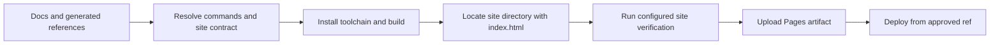

# Docs Deploy Pipeline

Documentation deployment turns validated source into a GitHub Pages artifact.
The workflow resolves repository-specific install, build, verify, site URL, and
site directory settings before it installs tools or publishes output.

## Docs Deploy Model

Build success, artifact validity, Pages deployment, and public reachability are
different claims. The workflow must preserve those distinctions in its result
and in any release evidence that cites the documentation site.

## Resolution and Publication

The workflow resolves configuration from repository variables, environment,
and `.github/docs-deploy.env`, then falls back to discovered Make targets. It
fails if no build command can be found. Python, uv, Node, and Rust setup are
enabled according to the resolved repository shape unless explicitly
configured.

Publication is a manual `deploy-docs` dispatch on accepted `main`, authorized
by the IaC publication controller. Its `accepted_commit` must match the exact
workflow source and current accepted repository revision. Pull requests, tags,
and other branches cannot publish.

`make gh-docs-install` selects the source-owned `history` renderer recipe:
Python 3.11.17 on Ubuntu 24.04 with the complete hash-locked documentation
closure. It installs into `artifacts/docs/publication/python`; this environment
is separate from ordinary documentation and application tools. Publication
uses the reviewed git revision plugin 1.6.0 while the normal documentation lock
remains independent.

`make gh-docs-build` checks the exact fetched Std pin and generated projection,
captures committed source identity, and renders the configured production
artifact through the shared qualified producer. It records reconstruction,
content security, routes and search verification before admitting the
publication manifest. `make gh-docs-verify` rechecks that manifest and its
source and bundle bytes without rebuilding.

The only selected bundle is `artifacts/docs/site`, at
`https://bijux.io/bijux-atlas/`. Missing artifacts, unqualified renderer profiles,
changed source or incomplete evidence fail before Pages upload. There is no
artifact-directory discovery or fallback render.

## Evidence Strength

| Observation | Safe conclusion | Still required for a stronger claim |
| --- | --- | --- |
| source validation passed | Markdown, metadata, navigation, and checked links satisfy the configured validator | rendered-site and deployment evidence |
| site directory contains `index.html` | a candidate Pages bundle has a root document | asset completeness and route behavior |
| configured site verifier passed | repository-specific publish checks accepted the selected bundle | Pages deployment result |
| upload action passed | GitHub accepted the artifact | successful deployment and public fetch |
| deploy action returned a URL | Pages reported a deployment | external route, asset, redirect, and cache checks when required |

The qualified producer proves the selected source and rendered artifact. A
successful Pages deployment and external site checks remain separate evidence;
local qualification alone does not establish public reachability.

## Operational Record

Retain the source revision, resolved site URL and directory, resolved commands,
tool versions, verification result, Pages artifact identity, deployment URL,
and workflow run. A public-site incident can then distinguish stale source,
build drift, incomplete assets, Pages failure, and routing failure.

Workflow authority: [`.github/workflows/deploy-docs.yml`](https://github.com/bijux/bijux-atlas/blob/main/.github/workflows/deploy-docs.yml).
Repository documentation checks are described in
[Docs Governance Workflow](../workflow-ownership/docs-governance-workflow.md).
